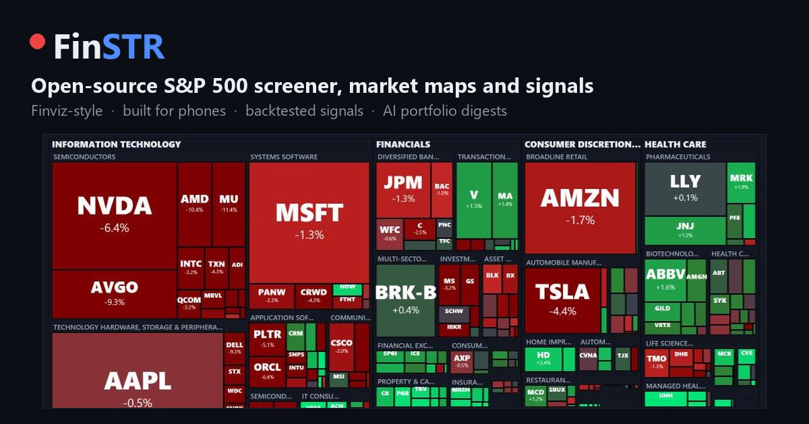

# FinSTR: Free, Open-Source Stock Research for the S&P 500

**Live site: [punch-k.github.io/FinSTR-app](https://punch-k.github.io/FinSTR-app/)** · Built by [Prapanch Kokkalemada](https://punch-k.github.io/Portfolio/)

[](https://punch-k.github.io/FinSTR-app/)

FinSTR is a Finviz-style research tool for all ~500 S&P 500 companies: a screener, market maps, a quote page for every
stock, a paper-portfolio tracker and scheduled AI portfolio digests. It explains what it shows (why a stock moved,
why a signal is strong) and publishes an honest record of how its signal performs. It runs entirely on free
infrastructure: a Python data pipeline on GitHub Actions and a static site on GitHub Pages.

## At a glance

| | |
|---|---|
| **What I built** | An end-to-end data product: automated data pipeline → scoring model → web app → AI automation (email digests, AI-assistant access) |
| **Scale** | 503 companies, ~90 fields each, 5 years of daily prices, refreshed hourly on US trading days (10:30 AM to 3:30 PM ET, plus 4:20 PM after the close); 503 generated stock pages |
| **Analytics** | Six-factor signal (trend, momentum, value, quality, growth, low risk) with a published backtest **and** a live, out-of-sample record that cannot be fitted after the fact |
| **AI and automation** | Scheduled digests by email, Telegram, Slack or phone push; an optional AI-written summary whose every number, ticker and claim is checked against computed facts before sending; an MCP server so AI assistants (Claude, Cursor) can use FinSTR |
| **Product** | Built mobile-first, predictive ticker search, sector pie that filters the screener, screen alerts, optional Google sign-in with synced portfolios |
| **Stack** | Python (pandas, yfinance) · GitHub Actions · GitHub Pages · JavaScript, D3, TradingView Lightweight Charts · Supabase (auth, Postgres with row-level security) · Resend |
| **Cost to run** | $0: no servers and no paid data |

## What it does

| Area | Features |
|---|---|
| **Screener** | 90+ fields · 12 column views (Overview, Valuation, Financial, Ownership, Performance, Technical, Analysts, Signals, …) · 30+ filters in one row · sector pie (click to filter) · predictive ticker search · watchlist · CSV export · shareable links · screen alerts |
| **Signals** | FinSTR Signal (0-100 percentile) with factor bars and plain-English reasons for every stock · monthly backtest · live out-of-sample record |
| **Quote page** | Candlestick chart with moving averages · peers · 78-field snapshot · 5-year and quarterly financials · earnings surprises · analyst ratings · headlines · insider trades · valuation sandbox · "why it moved" context |
| **Portfolio** | Paper portfolio: P&L, return vs the S&P 500 since each purchase, performance chart, sector mix, beta, rule-based points to consider (with trim amounts), diversification ideas, changes since your last visit |
| **Home** | Your followed stocks with one plain-English line each · market internals (median vs cap-weighted move, move histogram, day-vs-week reversals) · top movers · heat map |
| **Maps and markets** | Market-cap treemap and bubble view by timeframe · index cards, futures, currencies, crypto · sector and industry groups · earnings calendar · news |
| **Stock pages** | A fast, no-JavaScript page per company at `/stock/TICKER/` and an [A-Z index by sector](https://punch-k.github.io/FinSTR-app/stock/), rebuilt on every deploy |
| **Automation** | Email / Telegram / Slack / phone-push digests and alerts · [MCP server](#mcp-server-claude-cursor-and-other-ai-assistants) · every dataset as public JSON documented in [`llms.txt`](https://punch-k.github.io/FinSTR-app/llms.txt) |

## Data and method

- **Source:** Yahoo Finance via [`yfinance`](https://github.com/ranaroussi/yfinance) (prices, fundamentals, ownership, analyst data, insider trades) and Yahoo Finance RSS (headlines). Universe: S&P 500 constituents with official GICS sectors.
- **Computed consistently for every stock** from daily prices: performance (week to year, YTD), SMA 20/50/200 and distance from each, RSI (14, Wilder), volatility (std. dev. of daily returns), ATR (14), 52-week high/low, relative volume.
- **No invented numbers.** A field Yahoo does not report shows as "-", never as zero. There is no synthetic fallback data.
- **Keep-last-good.** If a ticker fails on a run, its previous values are carried over and flagged, so one bad run never blanks the site.
- **Freshness.** The site shows the snapshot time on every page. It refreshes hourly from 10:30 AM to 3:30 PM ET on trading days, plus 4:20 PM after the close (see [docs/SCHEDULER.md](docs/SCHEDULER.md)), and says so plainly when a refresh is late; it is not a live feed.
- **FinSTR Signal.** Six factor scores (trend, momentum, value, quality, growth, low risk), each a percentile vs the S&P 500; value and quality are ranked within sector. The price-based factors are backtested monthly (top vs bottom fifth vs the index) and published on the Signals page, including when they did not work.
- **Live record.** Separately from the backtest, the top and bottom fifth by signal are saved every trading day and
  measured afterwards ([`data/track.json`](https://punch-k.github.io/FinSTR-app/data/track.json), Signals page), so the
  record is out-of-sample by construction. It started on 20 Nov 2026; until it has months of data it is mostly noise.
- **Why it moved.** For every move of 3% or more, the pipeline checks for an earnings report in the last trading day,
  compares the move with its industry (market-cap weighted, the stock excluded) and picks the latest headline that names
  the company. It describes; it does not claim a cause. Shown on quote pages, stock pages, the Portfolio page and in digests.
- **Relative volume** is pace-adjusted during the session, so a stock that has traded half its usual volume by noon reads
  as busy, not quiet.
- **Not investment advice.** Signals and the valuation sandbox are transparent, educational tools.

## How it works

```
GitHub Actions, 4x per trading day
  └─ pipeline/fetch.py      Yahoo Finance → prices, fundamentals, analyst data, news for 503 companies
       ├─ signals.py        six-factor scores, composite signal, monthly backtest
       ├─ context.py        "why it moved" context, pace-adjusted relative volume
       ├─ track.py          live out-of-sample record (carried forward run to run)
       └─ pages.py          503 stock pages, index, sitemap
  └─ static site (index.html + data/*.json) ──► GitHub Pages

pipeline/digest.py   (GitHub Actions, scheduled)  portfolio review → email / Telegram / Slack / push
pipeline/mcp_server.py                            FinSTR tools for AI assistants
Supabase (optional)                               Google / email sign-in, synced portfolios
```

The data is generated on every deploy and published with the site, so it is never committed
to the repository.

## Portfolio and email digests

The **Portfolio** page tracks a paper portfolio in your browser: profit and loss, return against the S&P 500 since
each purchase, sector mix, beta, the value-weighted FinSTR Signal, rule-based points to consider for each position,
and strong-signal ideas in sectors you don't hold. You choose your email cadence there (weekly digest, daily summary,
trigger alerts) and export the portfolio as a JSON file.

### Email digests (self-hosted)

`pipeline/digest.py` turns that file plus the latest FinSTR data into a mobile-friendly email, and a short text
version for Telegram, Slack, Discord or phone push. It uses only the Python standard library.

An AI paragraph is optional: point it at any OpenAI-compatible model (a local Ollama model by default). Code computes
every number; the model only writes the paragraph, and its text is checked before it is sent. It is dropped, and the
rule-based summary used instead, if it:

- uses a number that is not in the computed facts (rounding allowed),
- names a ticker that is not in the portfolio or the ideas,
- puts a stock in the wrong sector, or quotes the wrong figure as the S&P 500 comparison,
- calls a gain a loss or the reverse.

The email says when this happened, so a degraded run is never silent.

Set it up in about 5 minutes, free, on your own GitHub account:

1. Fork this repository.
2. In your fork: **Settings > Secrets and variables > Actions**
   - Secret `PORTFOLIO_JSON`: paste the exported file.
   - At least one way to reach you (set any or all):

     | Channel | Secrets |
     |---|---|
     | Email (Resend) | `RESEND_API_KEY`, `MAIL_TO`. Free; without a verified domain Resend only delivers to your own Resend account address |
     | Email (SMTP) | `SMTP_HOST`, `SMTP_PORT` (587), `SMTP_USER`, `SMTP_PASS`, `MAIL_TO`. Gmail: `smtp.gmail.com` and an [app password](https://support.google.com/accounts/answer/185833) |
     | Telegram | `TELEGRAM_BOT_TOKEN` (from @BotFather), `TELEGRAM_CHAT_ID` |
     | Slack or Discord | `WEBHOOK_URL` (an incoming-webhook URL) |
     | Phone push | `NTFY_TOPIC`: install the free [ntfy](https://ntfy.sh) app and subscribe to a long random topic name only you know |
   - Variables: `FINSTR_DIGEST` = `true`. Optional: `FINSTR_LOCAL_AI` = `true` to run an open model on the runner,
     `LLM_MODEL` (default `llama3.2`), or secrets `LLM_BASE_URL` / `LLM_API_KEY` for a hosted model.
3. **Actions > FinSTR Digest > Run workflow** sends a test digest. After that it runs on schedule: Monday morning
   (weekly digest) and after each close (daily summary and trigger alerts), as your preferences say.

Run it locally instead:

```bash
python pipeline/digest.py --portfolio finstr-portfolio.json --mode weekly --out digest.html
LLM_BASE_URL=http://localhost:11434/v1 LLM_MODEL=llama3.2 python pipeline/digest.py --portfolio finstr-portfolio.json --mode weekly --out digest.html
```

Alerts fire when a holding falls 7% or more in a day, crosses its 200-day average, reports earnings within 3 days,
or its signal label changes. Screen alerts: in the Screener press **🔔 Alert** to save the current filters; the
Portfolio page and the digest then report each stock that newly enters that screen. Ideas skip companies that
report earnings within 5 days.

## For AI agents and automation

### MCP server (Claude, Cursor and other AI assistants)

`pipeline/mcp_server.py` lets any MCP client use FinSTR: no install beyond Python, no account, no API key.
Tools: `market_overview`, `search`, `stock`, `screen` (FinSTR rule format), `signal_record`, `portfolio_review`.

```json
{"mcpServers": {"finstr": {"command": "python", "args": ["/path/to/FinSTR-app/pipeline/mcp_server.py"]}}}
```

Then ask, for example: "Using FinSTR, review this portfolio" or "find S&P 500 stocks with a strong signal on a pullback".


Every number on the site is a static JSON file, documented in [`llms.txt`](https://punch-k.github.io/FinSTR-app/llms.txt):
`data/screener.json` (all companies, ~90 fields including the signal and its reasons), `data/quote/{TICKER}.json`
(price history, financials, estimates, rating changes), `data/signals.json` (weights and backtest), and more. Use them
from n8n, Zapier, scripts or an LLM tool with no API key. The Portfolio page's **Copy AI brief** button produces a
ready-made prompt with your holdings and their data for any AI assistant.

## Repository layout

| Path | What it is |
|---|---|
| `index.html` | The site: screener, maps, quote page, signals, portfolio, home, sign-in |
| `assets/` | Icon and social preview image |
| `pipeline/` | `fetch.py` data builder, `signals.py` signal engine and backtest, `digest.py` email digest, `universe.csv` (S&P 500 list), `requirements.txt` |
| `pipeline/context.py`, `pipeline/track.py` | "Why it moved" context and volume pace; the live out-of-sample signal record |
| `pipeline/pages.py` | Generates the per-stock pages, stock index and sitemap at deploy time |
| `pipeline/mcp_server.py` | MCP server for AI assistants (stdio, standard library only) |
| `docs/ROADMAP.md` | Product roadmap and comparison with other free tools |
| `privacy.html`, `terms.html` | Privacy Policy and Terms of Use (needed for sign-in) |
| `llms.txt` | Data documentation for AI agents and automation tools |
| `.github/workflows/deploy.yml` | Build and GitHub Pages deploy; a freshness gate (`pipeline/freshness.py`) rebuilds only when a refresh slot has passed |
| `.github/workflows/digest.yml` | Self-hosted email digest (fork, add secrets, receive emails) |
| `server/` | Optional local Flask app: MyShare portfolio/lot tracker (adapted from Vlad Litvak's MyShare) and the experimental Quant Desk. Not part of the live site. |
| `docs/` | Project notes and the earlier code-quality report |

## Run your own copy

Everything runs on a free GitHub account; there is no server or paid data feed.

1. Fork this repository.
2. In the fork: **Settings > Pages > Build and deployment > Source = GitHub Actions**.
3. **Actions > Build and deploy FinSTR > Run workflow**. About 5 minutes later the site is live at
   `https://<your-user>.github.io/FinSTR-app/` and refreshes on its own schedule. The workflow detects its own
   address, so nothing needs editing.
4. Optional: switch on [portfolio digests](#email-digests-self-hosted) in the same fork.

To track a different list of stocks, edit `pipeline/universe.csv` (ticker, name, sector, industry).

## Run it locally

```bash
pip install -r pipeline/requirements.txt
python pipeline/fetch.py            # about 5 minutes for the full S&P 500
python pipeline/fetch.py --limit 25 # quick test run
python pipeline/pages.py --out .    # optional: per-stock pages and sitemap
python -m http.server 8000          # then open http://localhost:8000
```

Optional local portfolio manager (MyShare):

```bash
cd server
pip install -r requirements.txt
python app.py                       # http://localhost:1817/myshare/home
```

## Tech

Python (pandas, yfinance) · GitHub Actions · GitHub Pages · vanilla JavaScript · D3 (treemap) · TradingView Lightweight Charts · Supabase (Auth, Postgres, row-level security) · Resend · Ollama / any OpenAI-compatible model (optional) · MCP
